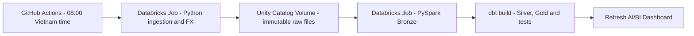

# Vietnam IT Job Market Lakehouse

A daily batch pipeline for the Vietnam IT job market. A Databricks Job collects public ITviec postings, preserves raw batches in a Unity Catalog Volume, loads Delta Bronze tables with PySpark, transforms data with dbt, and refreshes an AI/BI Dashboard. GitHub Actions schedules the Job and waits for its result.

The implemented scope covers Vietnam and ITviec. Singapore is a possible extension. The pipeline uses real source data and has no synthetic-data fallback.

## Analytical questions

1. Which 15 skills appear in the most postings in the latest complete snapshot? Monthly salary estimates in USD, sample counts, and salary coverage are reported separately.
2. How many observed postings were published on each date in Ha Noi, Ho Chi Minh City, and Da Nang?

This is a sample from one source, not a census of the job market. ITviec frequently requires sign-in to view salaries: the pipeline preserves `NULL` and does not access hidden salary information or replace missing salaries with zero. A posting associated with multiple cities counts once in each city, so city totals must not be added to estimate a national unique-posting count.

## Architecture



GitHub Actions is the only scheduler. Databricks owns the ingestion → Bronze → dbt → dashboard DAG; Bronze accepts only completed raw batches. The CLI waits for the entire Job and returns a nonzero exit code if a task fails. `max_concurrent_runs=1` and GitHub concurrency controls prevent overlapping pipeline executions.

- **Raw:** `jobs.parquet`, `fx.json`, and `manifest.json`, organized by Vietnam snapshot date and batch `run_id`. The manifest is written or uploaded last and records row counts and a SHA-256 checksum of the Parquet file.
- **Bronze:** one observation per `(source, source_job_id, run_id)`. MERGE inserts new observations without overwriting history. The `ingestion_runs` ledger is written after the observation merge; Silver excludes observations without a completed ledger entry.
- **Silver:** observation history, the current record for each posting, city/skill normalization, and monthly salary conversion. Python handles tested salary syntax parsing; dbt handles analytical rules, FX conversion, and modeling.
- **Gold:** a job-posting fact, company and skill dimensions, job–skill and job–city bridges, two analytical marts, and a data-quality audit table.

See the [architecture](docs/architecture.md), [source contract](docs/source_contract.md), [data dictionary](docs/data_dictionary.md), [runbook](docs/runbook.md), and [portfolio learning guide](docs/portfolio_learning_guide.md).

## Run from a clean checkout

Requirements: Python 3.12 or 3.13, uv, Terraform >=1.9, and a Databricks workspace with Unity Catalog and a serverless SQL warehouse. Free Edition has usage quotas and no SLA. Outbound access to ITviec and the FX provider has been verified in the deployed workspace; another workspace needs suitable outbound access.

```powershell
uv sync --locked --extra dev
Copy-Item .env.example .env
```

Fill in your private configuration in `.env`, which is excluded from Git:

```dotenv
DATABRICKS_HOST=https://your-workspace.cloud.databricks.com
DATABRICKS_TOKEN=your-private-token
DATABRICKS_HTTP_PATH=/sql/1.0/warehouses/your-warehouse-id
DATABRICKS_CATALOG=workspace
SCHEMA_PREFIX=vn_jobs
```

If you signed in with OAuth inside WSL but run Python on Windows, set `DATABRICKS_WSL_PROFILE=your-profile` together with the host and HTTP path. The WSL CLI acquires and refreshes access tokens in memory. When running directly in WSL, the SDK uses that profile normally. A personal OAuth session supports local operation; GitHub Actions uses separate credentials stored in GitHub Secrets.

```powershell
# Check authentication, catalog access, and SELECT 1 on the SQL warehouse.
uv run it-jobs check

# Generate a plan without applying infrastructure changes.
uv run python scripts/deploy.py

# Create schemas, the Volume, notebooks, source/dbt files, Job, and dashboard.
uv run python scripts/deploy.py --apply
```

Read `job_id` from the Terraform outputs, then run the pipeline:

```powershell
uv run it-jobs run --job-id YOUR_JOB_ID
```

You can also extract on a machine with source access and replay a saved real batch. During replay, the extraction task reuses the saved batch path instead of collecting a new snapshot:

```powershell
uv run it-jobs extract
uv run it-jobs replay --input artifacts/landing/YYYY-MM-DD/RUN_ID --job-id YOUR_JOB_ID
```

Do not assign historical snapshot dates to data collected today. Backfills replay previously preserved raw batches. Replaying the same batch does not duplicate Bronze observations; deploying revised dbt models and replaying creates a new Job execution.

If extraction succeeded but a later task failed, use `uv run it-jobs repair --job-id ID --run-id FAILED_RUN_ID` to rerun failed tasks and their dependents while reusing the completed extraction. Manual workflow dispatch also accepts `repair_run_id`. Scheduled runs leave it empty and collect a fresh snapshot.

## GitHub automation

After pushing the repository and deploying infrastructure:

1. Add Secrets: `DATABRICKS_HOST`, `DATABRICKS_TOKEN`, and `DATABRICKS_HTTP_PATH`.
2. Add Variables: `PIPELINE_JOB_ID`, `DATABRICKS_CATALOG=workspace`, and `SCHEMA_PREFIX=vn_jobs`.
3. Manually run **Daily Vietnam IT jobs** once to verify the workflow.
4. Set `ENABLE_DAILY_PIPELINE=true` to enable `01:00 UTC`, equivalent to `08:00` in Vietnam. GitHub may delay scheduled events.

Alternatively, run `uv run python scripts/configure_github.py --repo OWNER/REPO --job-id ID`. The script retains an existing token secret. If none exists, it creates a 90-day Databricks PAT and passes it directly to GitHub Secrets through stdin without writing its value to a file or log. If secret upload fails, the new token is revoked. The script leaves the daily schedule disabled until manual workflow verification succeeds.

Keep Terraform state, plans, credentials, raw files, and raw FX snapshots out of Git. Preserve the existing state when managing deployed resources; use a private remote backend for a shared deployment workflow. Do not apply from an empty state on an ephemeral runner.

## Quality checks

```powershell
uv run ruff check .
uv run pytest -q
uv run dbt parse --project-dir dbt --profiles-dir dbt --no-partial-parse
terraform -chdir=infra/terraform fmt -check
terraform -chdir=infra/terraform validate
```

Unit tests cover salary parsing, source-contract changes, pagination, and raw-file integrity. SQL tests in `tests/` execute models after lowering Spark syntax to DuckDB to check business semantics; they do not replace Databricks runtime validation. Cloud `dbt build` checks keys, relationships, grain, freshness, per-run row counts, and salary semantics. Low salary coverage produces a warning because missing salaries are a source limitation, not a reason to generate replacement data.

## Sources and operating limits

- [ITviec](https://itviec.com/it-jobs): public pages only, with robots.txt checks, rate limiting, timeouts, and retries. Source-contract changes or incomplete extraction fail the run explicitly.
- [Rates By Exchange Rate API](https://www.exchangerate-api.com): a daily open-access FX endpoint. The actual provider timestamp is preserved. Raw FX responses remain private in the Volume and are not redistributed. See the [endpoint terms](https://www.exchangerate-api.com/docs/free).
- [Databricks Free Edition limitations](https://docs.databricks.com/aws/en/getting-started/free-edition-limitations): serverless resources and usage quotas; the project aims to stay within those limits, not to promise unlimited operation.
- [Zoomcamp rubric](https://raw.githubusercontent.com/DataTalksClub/data-engineering-zoomcamp/main/projects/README.md): the reviewed rubric has 28 technical points. The project does not claim full marks without execution and reproducibility evidence.
