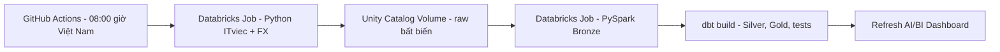

# Vietnam IT Job Market Lakehouse

Pipeline batch hằng ngày cho thị trường việc làm IT Việt Nam. Databricks Job lấy dữ liệu ITviec công khai, lưu nguyên bản vào Unity Catalog Volume, nạp Delta Bronze bằng PySpark, biến đổi bằng dbt và refresh Databricks AI/BI Dashboard. GitHub Actions đặt lịch và chờ Job.

Phạm vi hiện tại là Việt Nam; Singapore được giữ ở hướng mở rộng, chưa tuyên bố đã tích hợp. Không có chế độ demo, dữ liệu sinh tự động hoặc fallback sang dữ liệu giả.

## Câu hỏi phân tích

1. Top 15 kỹ năng xuất hiện trong nhiều tin nhất ở lần thu thập đầy đủ gần nhất. Lương USD/tháng, số mẫu và tỷ lệ đủ dữ liệu được hiển thị riêng.
2. Số tin pipeline đã quan sát, nhóm theo ngày đăng gốc và thành phố: Hà Nội, TP.HCM, Đà Nẵng.

Đây là mẫu dữ liệu từ một nguồn, không phải thống kê toàn bộ thị trường. ITviec thường yêu cầu đăng nhập để xem lương: pipeline giữ `NULL`, không lấy giá trị bị ẩn, không đặt lương bằng 0. Một tin có nhiều thành phố được đếm một lần tại mỗi thành phố; không cộng các thành phố để suy ra tổng số tin toàn quốc.

## Kiến trúc



GitHub Actions là nơi duy nhất đặt lịch. Job trên Databricks sở hữu DAG thu thập → Bronze → dbt → dashboard; Bronze chỉ nhận batch raw hoàn chỉnh. CLI chờ toàn bộ Job kết thúc và trả mã lỗi khi một task thất bại. `max_concurrent_runs=1` và GitHub concurrency tránh các lượt ghi chạy chồng nhau.

- **Raw:** `jobs.parquet`, `fx.json`, `manifest.json`; tên thư mục chứa ngày Việt Nam và `run_id`. Manifest được ghi/upload sau cùng, có số dòng và checksum SHA-256.
- **Bronze:** mỗi dòng là một quan sát của `(source, source_job_id, run_id)`. MERGE chỉ chèn quan sát mới, không ghi đè lịch sử. Ledger `ingestion_runs` được ghi sau MERGE; dữ liệu chưa có ledger không đi vào Silver.
- **Silver:** lịch sử quan sát, bản hiện tại mỗi tin, chuẩn hóa thành phố/kỹ năng và quy đổi lương. Python chịu trách nhiệm phân tích cú pháp lương có unit tests; dbt thực hiện quy tắc phân tích, FX và mô hình hóa.
- **Gold:** fact tin tuyển dụng, dimension công ty/kỹ năng, bridge job–skill và job–city, hai marts phân tích và bảng kiểm tra chất lượng.

Chi tiết: [kiến trúc](docs/architecture.md), [hợp đồng nguồn](docs/source_contract.md), [từ điển dữ liệu](docs/data_dictionary.md), [vận hành](docs/runbook.md).

## Chạy từ đầu

Yêu cầu: Python 3.12 hoặc 3.13, uv, Terraform >=1.9, một workspace Databricks có Unity Catalog và SQL warehouse serverless. Free Edition có quota, không có SLA. Workspace triển khai đã được kiểm chứng truy cập ITviec và FX từ serverless; một workspace khác cần có chính sách outbound phù hợp.

```powershell
uv sync --locked --extra dev
Copy-Item .env.example .env
```

Điền `.env` bằng cấu hình riêng của bạn. File này bị loại khỏi Git:

```dotenv
DATABRICKS_HOST=https://your-workspace.cloud.databricks.com
DATABRICKS_TOKEN=your-private-token
DATABRICKS_HTTP_PATH=/sql/1.0/warehouses/your-warehouse-id
DATABRICKS_CATALOG=workspace
SCHEMA_PREFIX=vn_jobs
```

Nếu đã đăng nhập OAuth trong WSL nhưng chạy Python trên Windows, dùng `DATABRICKS_WSL_PROFILE=your-profile` cùng host và HTTP path; không cần chép token ra file. CLI trong WSL sẽ cấp/refresh token trong bộ nhớ. Khi chạy trực tiếp trong WSL, profile được dùng qua SDK thông thường. Phiên OAuth cá nhân phù hợp chạy thủ công; chạy GitHub Actions cần thông tin xác thực riêng được lưu trong GitHub Secrets.

```powershell
# Kiểm tra đăng nhập, catalog và thực thi SELECT 1 trên warehouse.
uv run it-jobs check

# Tạo plan. Không thay đổi cloud ở bước này.
uv run python scripts/deploy.py

# Áp dụng plan tạo schema, Volume, notebook, project dbt, Job và dashboard.
uv run python scripts/deploy.py --apply
```

Lấy `job_id` trong Terraform output, sau đó chạy pipeline:

```powershell
uv run it-jobs run --job-id YOUR_JOB_ID
```

Có thể thu thập riêng trên máy có quyền truy cập nguồn, rồi upload/nạp lại một batch thật. Khi replay, task extraction bỏ qua việc lấy dữ liệu mới và chuyển đúng đường dẫn batch đã lưu sang Bronze:

```powershell
uv run it-jobs extract
uv run it-jobs replay --input artifacts/landing/YYYY-MM-DD/RUN_ID --job-id YOUR_JOB_ID
```

Không dùng ngày quá khứ để tải tin hiện tại rồi gán thành lịch sử. Backfill chỉ dùng các batch raw đã lưu. Chạy lại cùng batch không nhân bản Bronze; sửa model dbt và replay sẽ tạo một lượt Job mới.

## Tự động hóa trên GitHub

Sau khi push repository và triển khai hạ tầng:

1. Thêm Secrets: `DATABRICKS_HOST`, `DATABRICKS_TOKEN`, `DATABRICKS_HTTP_PATH`.
2. Thêm Variables: `PIPELINE_JOB_ID`, `DATABRICKS_CATALOG=workspace`, `SCHEMA_PREFIX=vn_jobs`.
3. Chạy workflow **Daily Vietnam IT jobs** thủ công một lần để xác minh.
4. Đặt `ENABLE_DAILY_PIPELINE=true` để bật lịch `01:00 UTC`, tương ứng `08:00` giờ Việt Nam. GitHub có thể trì hoãn sự kiện cron.

Có thể tự cấu hình repository bằng `uv run python scripts/configure_github.py --repo OWNER/REPO --job-id ID`. Script giữ token đã có; nếu chưa có sẽ tạo PAT Databricks 90 ngày, gửi thẳng vào GitHub Secret qua stdin rồi bỏ giá trị khỏi bộ nhớ. Không ghi token vào file/log. Nếu gửi secret thất bại, token mới được thu hồi. Script để lịch tắt cho đến khi workflow thủ công đã được kiểm chứng.

Không đưa Terraform state, plan, token, file raw hay snapshot tỷ giá vào Git. Giữ state hiện tại khi tiếp tục quản lý tài nguyên; chuyển sang backend state riêng nếu có nhiều người triển khai. Không chạy Terraform apply trên runner dùng state rỗng.

## Kiểm tra chất lượng

```powershell
uv run ruff check .
uv run pytest -q
uv run dbt parse --project-dir dbt --profiles-dir dbt --no-partial-parse
terraform -chdir=infra/terraform fmt -check
terraform -chdir=infra/terraform validate
```

Unit tests kiểm tra cú pháp lương, nguồn thay đổi, pagination và toàn vẹn raw. SQL tests trong `tests/` thực thi model đã chuyển cú pháp sang DuckDB để kiểm tra nghiệp vụ; đây không phải runtime thay thế cho Databricks. `dbt build` trên cloud chạy kiểm tra khóa, quan hệ, grain, độ mới, số dòng mỗi run và ngữ nghĩa lương. Độ phủ lương thấp tạo cảnh báo vì thiếu lương là đặc tính nguồn, không phải lý do tạo dữ liệu thay thế.

## Nguồn và chi phí

- [ITviec](https://itviec.com/it-jobs): chỉ trang công khai, kiểm tra robots.txt, có giới hạn tốc độ, timeout và retry. Thay đổi HTML/JSON-LD hoặc snapshot thiếu làm pipeline thất bại rõ ràng.
- [Rates By Exchange Rate API](https://www.exchangerate-api.com): endpoint mở cập nhật hằng ngày, lưu thời điểm tỷ giá thực tế. Raw FX chỉ lưu riêng trong Volume, không phân phối lại. [Điều kiện endpoint](https://www.exchangerate-api.com/docs/free).
- [Giới hạn Databricks Free Edition](https://docs.databricks.com/aws/en/getting-started/free-edition-limitations): quota và serverless; mục tiêu là nằm trong hạn mức, không cam kết chạy vô hạn.
- [Rubric Zoomcamp](https://raw.githubusercontent.com/DataTalksClub/data-engineering-zoomcamp/main/projects/README.md): hiện có 28 điểm kỹ thuật; không tự tuyên bố đạt điểm tối đa khi chưa có bằng chứng chạy và tái lập.
