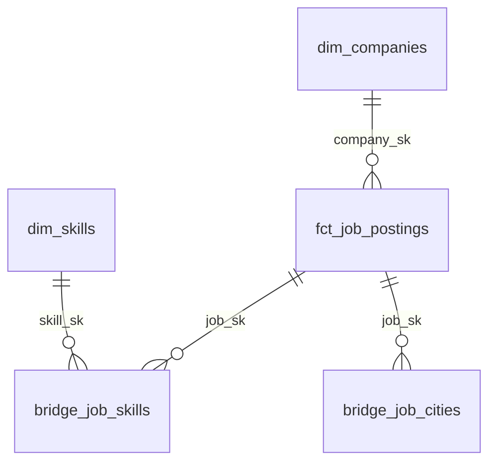

# Architecture and design decisions

## Responsibilities

`src/sea_it_jobs/sources/itviec.py` is the verified source adapter. The HTTP client handles robots.txt, request spacing, 429/5xx retries, and timeouts. The source adapter does not perform FX conversion or generate surrogate keys. `salary.py` parses salary syntax, preserves unknown bounds, and returns an explicit status when interpretation is unsafe. Raw source payloads are preserved alongside parser results.

`ingestion.py` completes the source snapshot, fetches real FX data, and writes Parquet with an explicit schema, including columns that are entirely NULL. `00_extract_source.py` runs the package on the Databricks driver and passes the raw path through a task value. `01_load_bronze.py` is independent of the Python package and validates/loads Bronze. dbt owns Silver, Gold, and analytical tests. `cloud.py` submits and waits for Jobs; local replay additionally verifies checksums and uploads immutable files.

## History and replay

The posting identity is `(source, source_job_id)`. The Bronze observation identity is `(source, source_job_id, run_id)`. This preserves multiple observations within a day and across days; idempotency does not require overwriting a single current-state record.

Raw batches and Bronze observations are immutable. Two replays of the same batch may create separate Job executions while preserving the same Bronze row count. An interrupted observation merge has no completed ledger entry, so staging excludes orphan observations. Each Delta MERGE is a separate transaction; notebook retries can complete the ledger after a failure between the merge and ledger write.

`first_seen_at` is the first observation recorded by the pipeline, `posted_date` comes from the source JobPosting JSON-LD, and `last_seen_at` is the latest observation. These fields are not silently substituted for one another. `observed_in_latest_snapshot` compares the posting's batch `run_id` with the latest complete run for its source, including repeated collections on the same day. Absence from a snapshot is not treated as proof that a job closed.

## Analytical model

The fact contains one current record for each observed source posting. Company dimensions contain descriptive attributes rather than aggregates such as posting counts or average salaries. The skill bridge is unique by `(job_sk, skill_sk)`; the city bridge is unique by `(job_sk, city_name)`. Posting identities from different sites are not automatically merged: entity resolution would need its own rules.

The MVP does not need separate microservices, Kafka, Kubernetes, Airflow, or a date dimension. GitHub Actions triggers and waits for Databricks, which owns the complete DAG, including ingestion. During verification, the GitHub runner could not access the source, whereas the Databricks workspace returned HTTP 200 for ITviec and FX. Ingestion therefore runs on serverless compute. Terraform manages objects in an existing workspace; it does not create an account or provision a Free Edition cloud workspace.

## Salary and FX semantics

- `Up to` provides an upper bound; `From` provides a lower bound. Unknown bounds remain NULL.
- Hidden or negotiable salaries remain NULL. Unrecognized expressions are `unsupported`; the parser does not guess by taking the first number.
- Only monthly USD/VND amounts with `parsed` status are converted to USD per month. Annual/hourly values remain available in their native form and are excluded from monthly averages.
- A midpoint is calculated only when both bounds are known, including fixed salaries. This represents an advertised salary estimate, not actual compensation or a causal return to a particular skill.
- The FX observation is preserved with its provider timestamp and raw batch. Replay does not substitute today's rate. Missing FX or rates older than 48 hours fail extraction.

## Performance and operating limits

Gold starts with full rebuilds: hundreds or thousands of postings do not justify complex incremental logic. Immutable Bronze history provides a migration path to incremental models later. The fact can use Liquid Clustering on `posted_date`; daily partitioning and additional clustering keys should not be added without supporting query profiles.

Dashboard refresh depends on a successful dbt build. dbt does not provide one atomic transaction across every Gold table: direct queries during a rebuild can see tables from different points in the build. For this learning project, cached dashboard results and serialized runs are an accepted limit. Stronger consistency would require candidate schemas, validation, publication views switched by batch, and a platform with a suitable SLA.

Raw batches are retained for recovery. No automatic VACUUM or history deletion is configured. Monitor storage and agree on retention before implementing cleanup. Models/tests expose source counts, parse failures, missing dates, and freshness; task failures propagate to the CLI and GitHub Actions.
