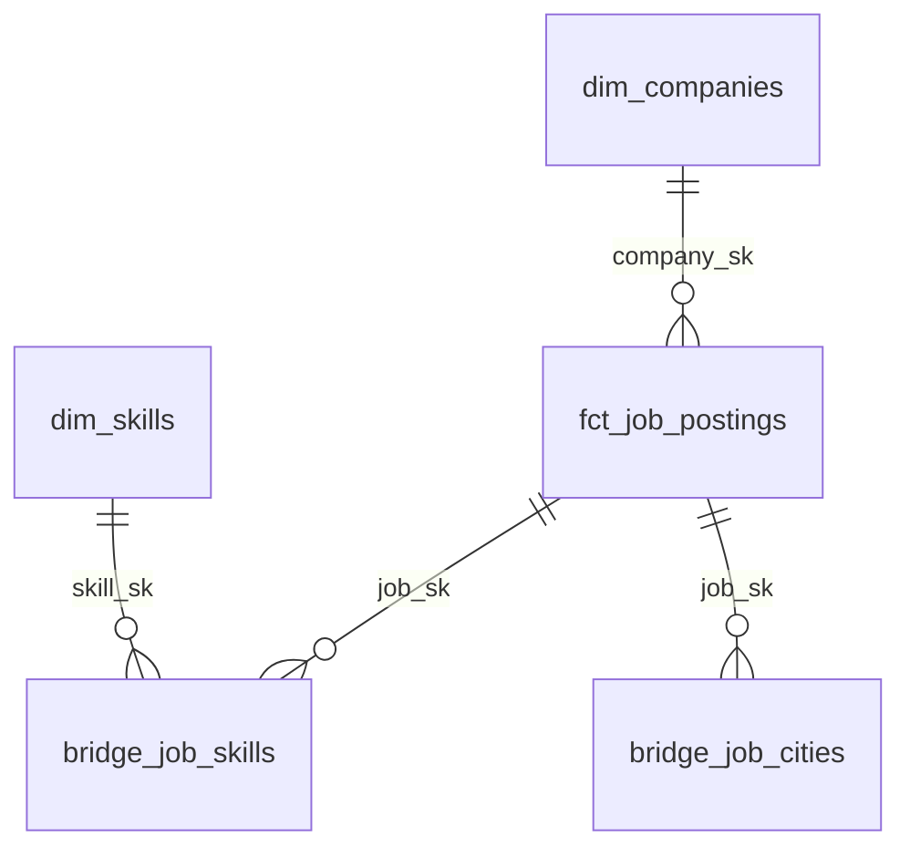

# Architecture

GitHub Actions starts the Job. Databricks runs extraction, Bronze loading, dbt, and dashboard refresh in order. If a task fails, the tasks that depend on it stop.

Ingestion runs inside Databricks because this workspace could reach ITviec while the GitHub runner could not.

## Data layers

| Layer | What it stores |
|---|---|
| Raw | Parquet, the FX response, and a batch manifest |
| Bronze | Every completed observation of a source post |
| Silver | Clean fields, skill/city mappings, and the latest record per post |
| Gold | Fact, dimension, bridge, and report tables |

Most Silver models are views. Gold models are tables. The SQL warehouse runs queries; the data stays in Delta tables.

## History and reruns

A post is identified by `(source, source_job_id)`. A Bronze row also includes the batch `run_id`.

Replaying the same batch adds no duplicate observations. A new batch can add another observation of the same post. Bronze writes its run ledger last, and Silver reads only batches listed there.

The fact holds one current record per post. Skill and city bridges handle posts with several skills or locations.

## Salary rules

Missing bounds stay NULL. Only known monthly USD/VND values are converted to USD. An average uses the midpoint only when both bounds are known. Each batch keeps the rate it used, so replay does not use a new rate.

## Tradeoffs

Gold uses full rebuilds because the dataset is small. Clustering on `posted_date` is available, but its benefit still needs measurement.

Each table update is separate. A failed dbt build does not roll back every Gold table, so direct queries during a build may see mixed versions. Dashboard refresh waits for a successful build. Raw history is retained; no automatic cleanup is configured.
