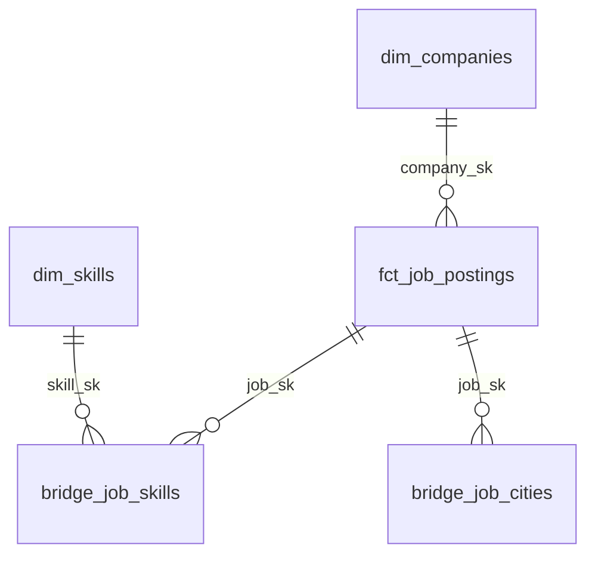

# Kiến trúc và quyết định thiết kế

## Ranh giới trách nhiệm

`src/sea_it_jobs/sources/itviec.py` là adapter đã kiểm chứng. HTTP client quản lý robots.txt, khoảng cách request, retry 429/5xx và timeout. Parser nguồn không xử lý FX hoặc tạo surrogate key. `salary.py` chỉ phân tích cú pháp, giữ nguyên cận chưa biết và trả trạng thái khi không thể diễn giải an toàn. Raw payload luôn đi kèm kết quả parser để có thể kiểm tra lại.

`ingestion.py` hoàn tất snapshot nguồn, lấy tỷ giá thực và ghi Parquet với schema tường minh, kể cả khi cả cột lương đều rỗng. `cloud.py` xác minh checksum, upload bất biến rồi chờ Job. Notebook độc lập với package Python, chỉ nạp và kiểm tra Bronze. dbt quản lý Silver/Gold và các kiểm thử phân tích.

## Lịch sử và chạy lại

Khóa tin là `(source, source_job_id)`. Khóa quan sát Bronze là `(source, source_job_id, run_id)`. Khóa này giữ được nhiều phiên bản trong cùng ngày và lịch sử qua nhiều ngày; không đồng nhất idempotency với việc ghi đè một dòng hiện tại.

Raw và quan sát Bronze bất biến. Hai lần replay cùng batch có thể tạo hai Job runs nhưng vẫn cùng số quan sát Bronze. Một run chưa hoàn tất MERGE sẽ không có ledger; staging join ledger nên loại các quan sát mồ côi. Mỗi MERGE Delta là giao dịch riêng; notebook có thể retry sau sự cố giữa MERGE và ledger.

`first_seen_at` là thời điểm pipeline bắt đầu quan sát tin; `posted_date` là ngày đăng trong JobPosting JSON-LD; `last_seen_at` là thời điểm quan sát gần nhất. Không thay thế âm thầm trường này bằng trường khác. `observed_in_latest_snapshot` so sánh `run_id` với run đầy đủ gần nhất theo nguồn, bao gồm trường hợp crawl lại trong cùng ngày. Tin không xuất hiện không tự được kết luận là đã đóng.

## Mô hình dữ liệu

Fact có một dòng hiện tại mỗi tin đã từng quan sát. Dimension công ty chứa thuộc tính công ty, không trộn số tin hoặc lương trung bình vào dimension. Bridge kỹ năng duy nhất theo `(job_sk, skill_sk)`; bridge thành phố duy nhất theo `(job_sk, city_name)`. Không tự gộp hai tin ở hai website thành một thực thể; entity resolution là bước mở rộng cần quy tắc riêng.

MVP không cần microservices, Kafka, Kubernetes, Airflow riêng hay dimension ngày. GitHub Actions khởi động và chờ Databricks; Databricks sở hữu DAG bên trong. Terraform chỉ quản lý tài nguyên workspace đã tồn tại, không tạo account hoặc cloud workspace Free Edition.

## Lương và tỷ giá

- `Up to` chỉ có cận trên; `From` chỉ có cận dưới. Không suy ra cận còn lại.
- Lương ẩn/thỏa thuận là NULL; biểu thức lạ là `unsupported`, không đoán bằng cách lấy con số đầu tiên.
- Chỉ đơn vị tháng, tiền tệ USD/VND và trạng thái `parsed` được quy đổi sang USD/tháng. Lương năm/giờ được giữ nguyên native, chưa đưa vào trung bình tháng.
- Lương khoảng hoặc cố định có hai cận mới được tính midpoint. Đây là lương quảng cáo, không phải lương thực nhận hay tác động nhân quả của một kỹ năng.
- Tỷ giá gắn với lần quan sát và được lưu cùng raw; replay không dùng tỷ giá hôm nay. Thiếu hoặc cũ quá 48 giờ làm run thất bại.

## Hiệu năng, giới hạn và vận hành

Khởi đầu bằng full rebuild Gold: vài trăm đến vài nghìn tin không cần logic incremental phức tạp. Lịch sử bất biến ở Bronze cho phép chuyển sang incremental sau này. Fact có thể dùng Liquid Clustering theo `posted_date`; không partition mỗi ngày và không thêm nhiều khóa khi chưa có query profile chứng minh lợi ích.

Refresh dashboard phụ thuộc dbt build thành công. dbt không cung cấp giao dịch nguyên tử cho toàn bộ nhiều bảng Gold: trong lúc rebuild, truy vấn trực tiếp có thể thấy các bảng ở các thời điểm khác nhau. Với đồ án dùng dashboard cache và một lượt chạy, đây là giới hạn được chấp nhận. Nếu cần SLA/đọc nhất quán, triển khai candidate schema, validation rồi chuyển các view xuất bản theo batch và dùng nền tảng có SLA.

Lưu raw để phục hồi, không tự VACUUM hoặc xóa lịch sử. Theo dõi dung lượng và thống nhất retention trước khi tự động dọn dữ liệu. Cảnh báo source count, parse failures, missing date và freshness có trong models/tests. Lỗi task được trả về CLI và GitHub Actions.
