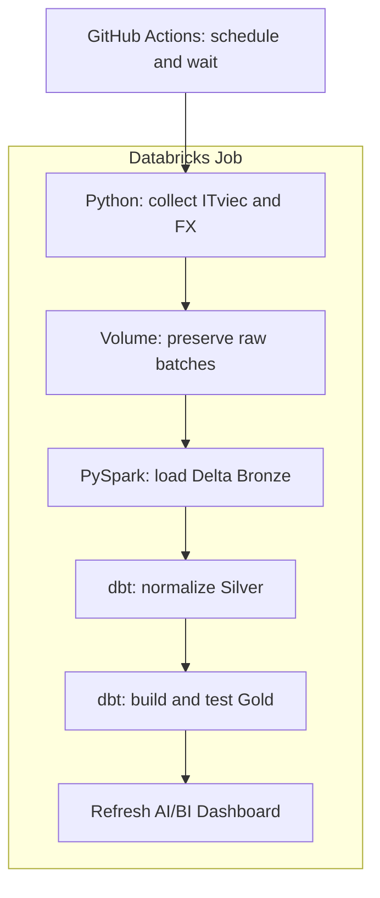

# Understand the project for your portfolio

This guide assumes basic Python and SQL knowledge and introduces the Data Engineering concepts used in this repository. Read it in order. For each component, identify its inputs, outputs, design decisions, and failure behavior.

## 1. What problem does the project solve?

A recruitment website helps people find jobs. Analyzing skill demand over time requires structured records, observation history, and consistent counting rules.

This project automatically collects public ITviec postings and turns them into SQL-queryable tables. Its two main outputs are:

- Skills appearing in the most postings in the latest complete snapshot.
- Counts of observed postings grouped by source publication date and city.

The pipeline processes data in **batches**, currently scheduled daily. It does not update immediately whenever the website publishes a new job.

The implemented scope is Vietnam and ITviec. Singapore and other sources are possible extensions. The verification on 7 November 2026 collected 632 postings; that number describes the verified snapshot, not a fixed website total.

## 2. The system map



Each tool has a distinct role:

| Tool | Responsibility in this project |
|---|---|
| Python, requests, BeautifulSoup | Fetch public pages and parse HTML/JSON-LD |
| PyArrow, Parquet | Write columnar files with explicit data types |
| Unity Catalog Volume | Store raw files under workspace access controls |
| PySpark | Read, validate, and load raw batches into Bronze |
| Delta Lake | Provide a transactional table format with MERGE support |
| dbt | Manage SQL models, dependencies, seeds, and data tests |
| SQL warehouse | Execute SQL on Databricks |
| Terraform | Declare and deploy workspace resources as code |
| GitHub Actions | Run CI and schedule pipeline executions |

A **SQL warehouse is compute**. Project data lives in Delta tables; starting/stopping a warehouse manages query resources. See the [Databricks documentation](https://docs.databricks.com/aws/en/compute/sql-warehouse/).

Follow the data flow when reading code rather than reading every directory alphabetically.

## 3. Follow a real posting

The preserved 7 November 2026 batch contains a posting from MB Bank:

```text
source              = itviec
source_job_id       = f858e2b0-8b7b-4865-9352-1cd310f52a9b
company_name        = MB Bank
posted_date         = 2026-10-23
snapshot_date       = 2026-11-07
locations           = [Hà Nội]  # Original Vietnamese source value
skills              = [AI, LLM, Deep Learning, Machine Learning, Computer Vision, NLP]
salary_text         = NULL
salary_parse_status = undisclosed
```

The source says the posting was published on 23 October; the pipeline observed it in the 7 November batch. Those dates answer different questions. A NULL salary means public information is unavailable for calculation, not that compensation is zero.

## 4. Ingestion: website content becomes Python records

Read [sources/itviec.py](../src/sea_it_jobs/sources/itviec.py) in this order:

1. `parse_listing()` reads source IDs, detail URLs, titles, companies, skills, and salary visibility from listing pages.
2. `extract()` determines the last page, traverses pagination, and deduplicates source IDs.
3. `parse_detail()` reads JobPosting JSON-LD from each detail page to obtain publication dates and locations more precisely than relative-age labels on listing cards.

Here, **JSON-LD** is JSON embedded in HTML. The project parses public pages and their structured content; it does not depend on a recruitment REST API with a stability guarantee.

[http.py](../src/sea_it_jobs/http.py) handles request spacing, timeouts, 429/5xx retries, and robots.txt. These controls help turn a one-off HTTP script into a component that can run repeatedly.

Source checks reject repeated/empty pages, excessive page counts, and suspiciously low collection relative to the advertised total. The 90% threshold detects anomalies; it does not prove complete market coverage.

**Key point:** HTTP 200 can still contain changed HTML. The adapter must also find the expected cards and JobPosting objects.

## 5. Salary parsing and raw batches

[salary.py](../src/sea_it_jobs/salary.py) parses salary syntax. The following are tested parser examples, not salaries observed in the real batch:

| Input string | Native result |
|---|---|
| `$1000 - $1800` | min=1000, max=1800, range |
| `Up to $3000` | min=NULL, max=3000, upper_bound |
| `From $1500` | min=1500, max=NULL, lower_bound |
| `15,5 triệu` (Vietnamese: 15.5 million) | min=max=15,500,000 VND |
| `Thỏa thuận` (Vietnamese: negotiable) | Both bounds NULL, undisclosed |

The parser preserves annual/hourly units without treating them as monthly salaries. Expressions it cannot interpret safely receive `unsupported` status.

The `collect()` function in [ingestion.py](../src/sea_it_jobs/ingestion.py) combines the adapter and parser, fetches real FX data, and writes a batch:

```text
.../itviec/YYYY-MM-DD/BATCH_RUN_ID/
├── jobs.parquet
├── fx.json
└── manifest.json
```

- `jobs.parquet`: records, observation metadata, raw source payloads, and parser results.
- `fx.json`: rates and the provider's update timestamp.
- `manifest.json`: row count, checksum, batch identity, and completion marker.

Parquet is columnar and has a data schema. The code declares types explicitly so entirely NULL columns retain their intended type instead of being inferred inconsistently across batches.

The manifest is written last. An extraction failure leaves no completion marker, so the batch cannot proceed to Bronze. SHA-256 detects changes to file content; it does not establish that an employer's job advertisement is factually correct.

**Two different manifests:** the raw `manifest.json` controls a data batch. `dbt/target/manifest.json` is dbt-generated project/DAG metadata. They serve different purposes.

## 6. Raw and Bronze: why preserve both?

Raw files support inspection and recovery by batch. Bronze supports consistent table queries and MERGE operations. Keeping both accepts extra storage in exchange for traceability and reprocessing.

[01_load_bronze.py](../notebooks/01_load_bronze.py) performs these steps:

1. Validate that the input path belongs to the project's Volume.
2. Check the manifest, completion flag, checksum, and row count.
3. Reject duplicate observation keys within the batch.
4. MERGE new observations into Delta.
5. Write the `ingestion_runs` ledger last.

Delta Lake adds transactional table behavior. See the [Delta Lake documentation](https://docs.delta.io/latest/delta-intro.html).

The Bronze key is:

```python
keys = ["source", "source_job_id", "run_id"]
```

This defines the table's **grain**: one observation of a posting in one batch.

| Situation | Bronze result |
|---|---|
| Load batch R1 for the first time | Insert R1 observations |
| Replay exactly the same R1 batch | Do not reinsert existing keys |
| Collect a new R2 batch containing the same posting | Add its R2 observation to preserve history |

**Idempotency** means repeated loading of the same input does not duplicate its data result. Adding observations for a new batch is intentional history retention.

The ledger confirms that a batch finished loading into Bronze. Silver includes only observations with a matching ledger entry. If the observation merge succeeds but the ledger write fails, retry can complete the ledger without duplicating observations.

Distinguish three IDs:

| ID | Represents |
|---|---|
| `run_id` in raw/Bronze | A data batch created by `collect()` |
| Databricks run ID | One execution of a Databricks Job |
| GitHub Actions run ID | One execution of a GitHub workflow |

Replay can create a new Databricks run ID while retaining the original batch `run_id`.

## 7. Silver and dbt: normalize data with SQL

A **dbt model** usually contains a SQL SELECT. dbt creates a view or table according to configuration. Staging/intermediate models in this project are mainly views, while Gold models are tables. Not every model creates another physical data copy.

In SQL:

```sql
from {{ ref('stg_job_history') }}
```

`ref()` resolves the relation's actual name and declares a dependency on `stg_job_history`. Dependencies form a DAG: a directed graph without cycles. dbt processes resources in dependency order.

`dbt build` builds selected resources and executes tests in DAG order. See the [dbt build documentation](https://docs.getdbt.com/reference/commands/build).

Start with three models:

| Model | Responsibility |
|---|---|
| [stg_job_history.sql](../dbt/models/staging/stg_job_history.sql) | Join the ledger, create keys, cast types, parse JSON arrays, and convert monthly salary bounds |
| [int_jobs_current.sql](../dbt/models/intermediate/int_jobs_current.sql) | Select the latest observation per posting and preserve first/last observation timestamps |
| [int_job_skills.sql](../dbt/models/intermediate/int_job_skills.sql) | EXPLODE arrays, normalize aliases, and deduplicate posting–skill pairs |

The central window function is:

```sql
row_number() over (
    partition by job_sk
    order by ingested_at desc, run_id desc
) as observation_rank
```

SQL groups observations by posting, then places the latest observation first within each group. `where observation_rank = 1` retains one record per posting.

- `first_seen_at`: the first observation retained by the pipeline.
- `last_seen_at`: the latest observation.
- `posted_date`: the website's publication date.
- `observed_in_latest_snapshot`: present in the source's latest complete batch.

Absence from the latest batch is not enough evidence to declare a job closed. The fact retains the posting and changes its presence flag.

Aliases live in `dbt/seeds/`: for example, `python` → `Python`, `apache spark` → `Spark`, and the Vietnamese source label `hà nội` → `Ha Noi`. Unmapped skill names remain lowercase instead of receiving an invented classification.

## 8. Gold: facts, dimensions, bridges, and marts

| Type | Relation | Grain |
|---|---|---|
| Fact | `fct_job_postings` | One source posting with its current observed attributes |
| Dimension | `dim_companies` | One company identity within a source |
| Dimension | `dim_skills` | One normalized skill name |
| Bridge | `bridge_job_skills` | One posting–skill pair |
| Bridge | `bridge_job_cities` | One posting–city pair |
| Mart | `mart_skill_demand` | One skill with demand/salary metrics |
| Mart | `mart_daily_city_jobs` | One publication-date–city combination |

The fact holds the central analytical records and measures. Dimensions provide grouping context. Bridges represent many-to-many relationships. Marts prepare results for a specific analytical use.

The MB Bank example has one fact record and six skill-bridge pairs. Those skills may already exist in the dimension because other postings also require them.

Duplicating the entire posting in the fact for every skill would make posting counts and salary aggregates easy to inflate. A bridge makes the relationship explicit, but SQL authors must still control grain when joining tables.

[mart_skill_demand.sql](../dbt/models/marts/reports/mart_skill_demand.sql) calculates:

```sql
count(distinct f.job_sk) as job_count,
count(f.avg_salary_usd) as salary_sample_count,
avg(f.avg_salary_usd) as avg_salary_usd
```

`COUNT(DISTINCT ...)` counts postings; `COUNT(avg_salary_usd)` counts only postings with a salary value. Strong observed demand can coexist with insufficient salary information.

City counts have a separate rule: a posting associated with two cities counts once in each. Summing city counts can therefore exceed the national unique-posting count.

## 9. Orchestration and failure recovery

Read [.github/workflows/pipeline.yml](../.github/workflows/pipeline.yml), [cloud.py](../src/sea_it_jobs/cloud.py), and the `databricks_job` resource in [main.tf](../infra/terraform/main.tf).

At the scheduled time, GitHub Actions invokes the CLI. The CLI uses the SDK to submit a Databricks Job and wait for its result. The Job owns four tasks:

```text
extract_source → load_bronze → dbt_build → refresh_dashboard
```

`depends_on` defines ordering. A failed dbt build prevents dashboard refresh. `max_concurrent_runs=1` and GitHub concurrency controls limit overlapping executions.

Three execution modes serve different needs:

| Command | Purpose |
|---|---|
| `run` | Collect a fresh source snapshot on Databricks |
| `replay` | Upload and process a real raw batch preserved locally |
| `repair` | Rerun failed tasks and their dependents within a Databricks run, reusing successful extraction |

A real integration issue occurred when the Job parameter `input_path` automatically overrode a Bronze notebook parameter with the same name. The fix gives Bronze a separate `raw_path` widget populated from a task value. This demonstrates why local tests need to be complemented by cloud integration verification.

Ingestion runs on Databricks because that workspace could access ITviec while the GitHub runner encountered source-access errors. GitHub remains responsible for scheduling and code validation.

## 10. Terraform, configuration, and CI

Terraform describes desired schemas, Volumes, workspace files, notebooks, Jobs, and dashboards. It does not extract or transform job data.

- `plan`: preview proposed changes.
- `apply`: execute changes.
- `state`: map declared resources to deployed resource IDs.

A plan alone does not apply the proposed infrastructure changes. See the [Terraform plan documentation](https://developer.hashicorp.com/terraform/cli/commands/plan).

`uv.lock` locks Python dependencies; `.terraform.lock.hcl` locks provider versions/checksums. Neither is Terraform state. State, plans, and `.env` stay outside Git.

[config.py](../src/sea_it_jobs/config.py) handles Databricks connections and using WSL OAuth from Windows Python. `scripts/` supports deployment, dashboard generation, and GitHub Secret configuration. Study these after understanding the data flow.

[ci.yml](../.github/workflows/ci.yml) runs lint, tests, dbt parse, and Terraform fmt/init/validate on push/PR. CI alone does not prove live-source access or a successful cloud execution; the data workflow and Databricks verification cover those concerns. CI does not automatically apply Terraform after each push.

## 11. Tests and limitations to understand

- `tests/test_salary.py`: salary syntax, unknown bounds, pay periods, and ambiguous input.
- `tests/test_sources.py`: HTML/JSON-LD contracts and pagination.
- `tests/test_integrity.py`: tampered raw files and incomplete batches.
- `tests/test_models.py`: grain, observation history, skill normalization, and analytical results.
- `dbt/models/schema.yml`, `dbt/tests/`: warehouse data quality.

Local SQL tests lower syntax to DuckDB to validate business semantics. They do not replace Databricks runtime checks. `dbt parse` also does not execute model SQL on real warehouse data.

[verification.md](verification.md) records the completed checks: 27 local tests and 38 dbt data tests, with 37 passing tests and one salary-coverage warning. Do not treat their sum as a single coverage score because they validate different layers.

Be prepared to explain these limits:

1. One public source does not represent the entire market. The verified snapshot contains no publicly disclosed salaries eligible for midpoint calculations.
2. Hundreds of postings do not establish a performance advantage for Spark or Liquid Clustering over smaller tools. This project demonstrates lakehouse engineering, not a big-data workload.
3. Gold currently uses full rebuilds. Observation history remains in Bronze/Silver; the Gold fact represents current attributes for each posting.
4. dbt does not wrap all Gold tables in one transaction. Dashboard refresh waits for build success, but direct queries during rebuilding can observe tables from different stages of the build.
5. Free Edition and public web sources have operating limits; a successful execution does not create an SLA.

## 12. Learning order and exercises

Choose one topic per session, roughly 45–90 minutes if useful. These are study suggestions, not required durations.

| Session | Read or practice | Learning outcome |
|---|---|---|
| 1 | Sections 1–3, README, a real manifest | Draw the flow and distinguish publication/observation dates |
| 2 | `itviec.py`, `http.py`, `salary.py` | Follow HTML → dictionary → parser fields |
| 3 | `ingestion.py`, Bronze notebook | Explain raw files, manifests, grain, and idempotency |
| 4 | Staging, intermediate models, seeds | Understand `ref()`, window functions, and normalization |
| 5 | Fact/dimension/bridge/mart models | Write joins at the right grain and explain metrics |
| 6 | Workflow, `cloud.py`, Terraform | Follow triggers, dependencies, and recovery |
| 7 | Tests, runbook, verification | Validate a small change and explain its tradeoffs |

Read-only SQL exercises for Databricks:

```sql
SELECT count(*) AS observations,
       count(DISTINCT run_id) AS batches
FROM workspace.vn_jobs_bronze.raw_it_job_observations;

SELECT count(*) AS distinct_source_jobs
FROM workspace.vn_jobs_gold.fct_job_postings;

SELECT skill_name, job_count, salary_sample_count, salary_coverage
FROM workspace.vn_jobs_gold.mart_skill_demand
ORDER BY job_count DESC, skill_name
LIMIT 15;
```

Explain why observations can outnumber postings and why `job_count > 0` can coexist with `salary_sample_count = 0`. Counts will change as later batches arrive.

For a small independent change, add a justified skill alias, write a corresponding test case, and inspect its effect on grain and metrics. Editing a local CSV only changes that file: understand deployment and dbt seed/build before expecting the cloud data to change.

Present the portfolio in this order: problem → data flow → design decisions → verification evidence → limitations. Be able to explain history retention, the need for bridges, the batch choice, and failure behavior.
